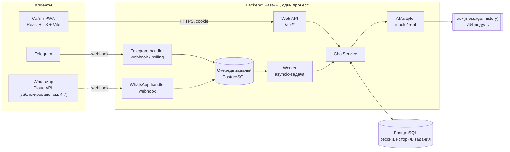

# Архитектура Adal AI (часть приложения)

> Статус: **предложение**, не утверждено командой. Документ описывает, как устроены
> сайт, PWA, серверный слой и каналы (Telegram, WhatsApp). ИИ-часть разрабатывает
> другой участник команды; граница с ней описана в [AI_CONTRACT.md](AI_CONTRACT.md).
>
> Тематика определена положением конкурса «Адал қоғам», п. 4.1. Adal AI —
> консультант и справочник-навигатор по внутренней политике и идеологической работе
> Казахстана на казахском и русском языках. Это студенческий конкурсный проект, а не
> официальный государственный сервис и не универсальный помощник. Требования и их
> выполнение — в [COMPETITION_REQUIREMENTS.md](COMPETITION_REQUIREMENTS.md).

## 1. Общая схема



Ключевое правило: **вся бизнес-логика находится в `ChatService`**. Обработчики каналов
только переводят входящие данные во внутренний формат и форматируют ответ для своего канала.
Подготовка истории, лимиты, вызов ИИ, проверка ответа и обработка ошибок не дублируются.

## 2. Стек

В репозитории нет кода и договорённостей о стеке (см. аудит в
[PROJECT_CONTEXT.md](PROJECT_CONTEXT.md)), поэтому предлагается:

| Слой | Выбор | Почему |
|---|---|---|
| Frontend | React + TypeScript + Vite | Быстрый старт, типизация, простая сборка |
| Мобильный формат | PWA (`vite-plugin-pwa`) | Установка на телефон без магазинов приложений |
| Backend | Python + FastAPI | Предположительно тот же язык, что у ИИ-модуля: можно вызвать функцию напрямую |
| БД | PostgreSQL (SQLAlchemy 2 async + asyncpg, Alembic) | Сессии, история и очередь заданий в одном хранилище |
| Запуск | Docker Compose (`backend`, `db`) | Воспроизводимый запуск одной командой |

Python — **допущение**. Если ИИ-модуль окажется на другом языке или будет поставляться
HTTP-сервисом, меняется только реализация `AIAdapter` (см. AI_CONTRACT.md, раздел 6).

Чего сознательно нет: Kubernetes, микросервисов, Redis, брокера сообщений, второго
backend-фреймворка. Для MVP с одним процессом этого достаточно; точки роста отмечены ниже.

Версии зависимостей фиксируются на этапе каркаса: backend — `requirements.txt` с точными
версиями (`==`), frontend — `package-lock.json`. Совместимость с выбранной версией Python
проверяется установкой и тестами, а не предполагается.

## 3. Структура репозитория (предлагаемая)

```
adal-ai/
├── backend/
│   ├── app/
│   │   ├── main.py            # FastAPI, lifespan: БД, worker, проверка AI_MODE
│   │   ├── config.py          # чтение и проверка переменных окружения
│   │   ├── api/               # web-эндпоинты, формат ошибок
│   │   ├── channels/          # telegram.py, whatsapp.py — только адаптация канала
│   │   ├── services/          # chat_service.py, history.py, rate_limit.py
│   │   ├── ai/                # adapter.py (протокол), mock.py, real.py, normalize.py
│   │   ├── db/                # модели, сессия, миграции Alembic
│   │   └── jobs/              # очередь заданий и worker
│   ├── tests/
│   └── requirements.txt
├── frontend/                  # реализовано, см. frontend/README.md
│   ├── src/                   # api, chat, components, i18n
│   ├── dev/mockApi.ts         # mock /api/* только для dev-сервера
│   ├── public/                # logo.svg и иконки PWA
│   └── package.json
├── ai_core/                   # ИИ-модуль — зона ответственности ИИ-части
├── docs/
├── docker-compose.yml
├── .env.example
└── LICENSE                    # MIT, сохраняется без изменений
```

Каталог `ai_core/` — только предложение для случая, когда модуль поставляется Python-пакетом.
Название и место согласуются с ответственным за ИИ-часть.

## 4. Компоненты

### 4.1 ChatService

Единая точка обработки сообщения для всех каналов:

```
ChatService.reply(conversation, text) -> ChatReply | ChatError
```

1. Проверить `text`: не пустой после `strip()`, не длиннее `MAX_MESSAGE_CHARS`.
2. Проверить лимит запросов для разговора (и для IP в web-канале).
3. Взять блокировку разговора: одновременно обрабатывается только одно сообщение
   одного разговора, иначе история «перемешается». Параллельный запрос получает `CONVERSATION_BUSY`.
4. Загрузить историю из БД и подготовить её (раздел 4.3).
5. Вызвать `AIAdapter.ask(text, history)` с таймаутом `AI_TIMEOUT_SECONDS`.
6. Проверить и нормализовать ответ (AI_CONTRACT.md, раздел 4).
7. **Только при успехе** записать пару «вопрос — ответ» в одной транзакции.
   При ошибке история не меняется, поэтому в ней не бывает «вопроса без ответа».
8. Вернуть `ChatReply {answer, sources, status, ai_mode}`. Если модуль не передал `status`,
   поле пустое (AI_CONTRACT.md §2.3).

### 4.2 AIAdapter

Протокол с двумя реализациями. Режим выбирается переменной `AI_MODE`, у которой
**нет значения по умолчанию**: если она не задана, приложение не стартует.
Благодаря этому сервер не может незаметно оказаться в mock-режиме.

| | `AI_MODE=mock` | `AI_MODE=real` |
|---|---|---|
| Что вызывается | `MockAdapter`, без сети и ключей | функция из `AI_MODULE` (например `ai_core.main:ask`) |
| Ответ | Детерминированный нейтральный текст на RU/KZ: сам сообщает, что это тестовый ответ и ИИ не подключён; без правовых формулировок | Ответ модуля после нормализации |
| Источники | Пустой список или тестовые источники с пометкой «не настоящий» в названии | Только то, что вернул модуль |
| Ошибки | Управляемые тестовые сценарии по фиксированным фразам (например, имитация таймаута) | Реальные ошибки сопоставляются с кодами из раздела 6 |
| При старте | — | Импорт `AI_MODULE`. Если модуль не найден, приложение останавливается с понятным сообщением |

Режим возвращается в каждом ответе (`ai_mode`) и в `GET /api/config`. Отдельной пометки
«Демо» в интерфейсе и ботах нет (решение команды от 16.10.2026: баннер и метка убраны).
О mock-режиме сообщает только текст самих тестовых ответов, поэтому показывать mock
как работу ИИ на защите нельзя: для демонстрации нужен `AI_MODE=real`.

### 4.3 Подготовка истории

- История берётся **только из БД сервера**. Клиент отправляет одно поле `message`
  и не может передать историю или системные инструкции.
- В историю попадают только роли `user` и `assistant` из сохранённых пар.
- Текущее сообщение в `history` не входит: оно передаётся отдельно как `message`.
- Обрезка: последние `HISTORY_MAX_MESSAGES` сообщений и не больше `HISTORY_MAX_CHARS`
  символов суммарно. Удаляются самые старые **целые пары**.
- Источники прошлых ответов в историю не передаются, только `content`.

### 4.4 Web API

Один origin: FastAPI отдаёт собранный frontend и `/api/*`. Поэтому CORS не нужен,
а cookie работает без сторонних настроек.

| Метод | Путь | Назначение |
|---|---|---|
| `GET` | `/api/config` | `{"ai_mode": "mock" \| "real", "max_message_chars": 2000}` |
| `GET` | `/api/history` | `{"turns": [{"id", "question", "answer", "sources", "status", "ai_mode"}]}` — сохранённые пары по порядку |
| `POST` | `/api/chat` | `{"message", "lang", "client_id"}` → `{"answer", "sources", "status", "ai_mode"}` |
| `DELETE` | `/api/history` | «Новый диалог»: удалить сообщения текущего разговора → `204` |
| `DELETE` | `/api/session` | «Удалить мои данные»: удалить историю и сессию, сбросить cookie → `204` |
| `GET` | `/api/health` | Живость процесса и доступность БД; секреты не раскрываются |

`lang` — язык интерфейса (`ru` или `kk`). Он сохраняется у разговора, но в ИИ-модуль
передаётся только после согласования (AI_CONTRACT.md §2.4).

`client_id` — случайный id вопроса (до 64 символов), который создаёт клиент. Повтор после
ошибки отправляет тот же `client_id`. Если пара с таким id уже сохранена (например, ответ
пришёл после таймаута клиента), сервер возвращает её, а не создаёт второй вопрос.

Источник в ответе: `{"title", "url", "details"}`; `url` и `details` могут быть `null`.

Пока backend не готов, этот контракт реализует dev-mock во frontend
(`frontend/dev/mockApi.ts`): только в dev/preview-сервере Vite, всегда с `ai_mode: "mock"`.

Ошибки возвращаются в едином формате: `{"error": {"code": "AI_TIMEOUT", "retry_after": null}}`.
Текст ошибки на языке интерфейса подставляет клиент по коду. Сервер не возвращает
внутренние подробности.

### 4.5 Веб-сессия и владелец истории

- Анонимная сессия создаётся при первом запросе: случайный токен из 32 байт в cookie
  `adal_sid` с флагами `HttpOnly`, `Secure` (в production), `SameSite=Lax` и `Path=/api`.
- В БД хранится только SHA-256 токена. По утёкшей базе сессию не восстановить.
- Разговор определяется **только по cookie**. Идентификатор разговора от клиента не
  принимается, поэтому прочитать чужую историю нельзя.
- Изменяющие запросы (`POST`, `DELETE`) проверяют заголовок `Origin` по `ALLOWED_ORIGINS`
  как защиту от CSRF.

### 4.6 Telegram

- Production: webhook `POST /webhooks/telegram`. Проверяется заголовок
  `X-Telegram-Bot-Api-Secret-Token`, заданный при `setWebhook`.
  Локальная разработка: long polling (`TELEGRAM_MODE=polling`), публичный URL не нужен.
- Webhook только сохраняет задание (дедупликация по `update_id`) и сразу отвечает `200`.
  Ответ ИИ формирует worker и отправляет его через `sendMessage`.
- MVP работает только в личных чатах. Сообщения из групп игнорируются.
- Команды: `/start` (что это за бот, тематика, пометка «студенческий проект»), `/lang` (выбор RU / KZ), `/clear` (очистка истории), `/help`.
  Все тексты команд и ошибок есть на двух языках. Язык по умолчанию берётся из
  `language_code` пользователя Telegram: `kk` → KZ, иначе RU.
- Ответ отправляется **простым текстом без `parse_mode`**, чтобы HTML из ответа ИИ
  не интерпретировался. Длинные ответы делятся на части до 4096 символов. Источники
  выводятся списком «название — ссылка», а у источника без `url` ссылки нет.
- Разговор: ключ `("telegram", chat.id)`. С сайтом и WhatsApp он не объединяется.

### 4.7 WhatsApp: дополнение с внешним блокером

Техническая часть (Cloud API) простая. Проверка webhook выполняется через
`hub.verify_token`/`hub.challenge`, подпись `X-Hub-Signature-256` — через HMAC-SHA256
с app secret, отправка — через `POST /{PHONE_NUMBER_ID}/messages`, дедупликация — по id
сообщения. Обработчик устроен так же, как у Telegram.

**Ограничение — правила платформы.** В действующих «Условиях Meta для платформы
WhatsApp Business» (страница обновлена 23.09.2026, проверено 16.10.2026) есть пункт 4.7
«Поставщики ИИ». Он запрещает поставщикам ИИ доступ к платформе, если ИИ-технологии
являются её основной функцией; решение об этом принимает Meta. Продукт, описанный как
«ИИ-помощник с источниками», с высокой вероятностью попадает под этот запрет.
В прессе упоминаются временные меры регуляторов ЕС и Италии против этого правила.
Их статус по официальным источникам не проверен, и на странице условий региональных
исключений нет.

После уточнения тематики риск не исчез. Adal AI — тематический ИИ-консультант, и ИИ
в нём является основной функцией, поэтому сценарий по-прежнему может подпасть под п. 4.7
условий Meta. Кроме того, для Cloud API нужны аккаунт Meta Business, приложение и номер.

Решение: WhatsApp остаётся в плане как **дополнение команды с внешним блокером**
(положение называет WhatsApp допустимой, но не обязательной платформой, п. 4.3).
Канал реализуется только после того, как команда подтвердит допустимость сценария
по правилам Meta и получит доступ к API. Основной сценарий от этого не зависит.
Если сценарий недопустим, в README и презентации указывается причина.

### 4.8 Очередь заданий

Таблица `jobs` в PostgreSQL. Worker — asyncio-задача в том же процессе; задания
забираются через `SELECT … FOR UPDATE SKIP LOCKED`. Задания одного разговора
выполняются строго по очереди. Повторы при временной ошибке ограничены (`attempts`).
Если обработка не удалась, пользователь получает сообщение об ошибке, а не тишину.

Web-канал очередь не использует: `POST /api/chat` ждёт ответ синхронно, но не дольше
`AI_TIMEOUT_SECONDS`.

### 4.9 PWA

- Манифест, иконки 64/192/512 px и maskable 512 px, service worker из `vite-plugin-pwa`
  (режим `generateSW`, автообновление).
- Кэшируется **только статика интерфейса** (precache). Правил кэширования ответов нет,
  поэтому `/api/*` (история, сообщения) всегда идут в сеть. `/api/*` и `/webhooks/*`
  исключены из навигационного fallback. Без сети UI показывает «Нет подключения к интернету».
- В собранную страницу добавляется Content-Security-Policy: всё только с собственного
  origin, `object-src 'none'`. Изображения — только свои и `data:`.
- Для установки нужен HTTPS, поэтому PWA проверяется на опубликованном демо.
  На iOS приложение устанавливается вручную: «Поделиться → На экран „Домой“».
- Название и описание в манифесте есть на двух языках.

### 4.10 Языки: русский и казахский

Обязательно по п. 4.6 положения.

- **Интерфейс:** переключатель RU / KZ в шапке. Выбор хранится в `localStorage`
  (если хранилище недоступно, используется язык браузера: `kk*` → KZ, иначе RU)
  и передаётся в `POST /api/chat` как `lang`. Внутренний код казахского — `kk`.
- **Переводятся:** элементы интерфейса, примеры вопросов, состояния ответа, сообщения
  об ошибках, пометки и дисклеймер. Для web словари лежат во
  frontend, для ботов — в backend. Коды ошибок общие.
- **Вопросы и ответы:** язык ответа определяет ИИ-модуль. Как именно — согласуется
  (AI_CONTRACT.md §2.4); приложение не подмешивает язык в `message` или `history`.
- **Проверка:** полные диалоги на обоих языках, а не только перевод кнопок
  (COMPETITION_REQUIREMENTS.md, раздел 6). Казахские тексты проверяет носитель языка.

### 4.11 Состояния ответа и интерфейс

Интерфейс различает четыре состояния:

| Состояние | Откуда берётся | Как выглядит |
|---|---|---|
| Ответ | `status = answered` или `status` нет | Текст и блок источников, если они есть |
| Нужно уточнение | `status = needs_clarification` | Ответ оформлен как вопрос к пользователю |
| Нет подтверждённой информации | `status = insufficient_information` | Нейтральная пометка «В базе нет подтверждённой информации» |
| Техническая ошибка | Код ошибки из раздела 6 | Отдельный стиль, кнопка «Повторить», текст по коду |

- Пока модуль не передаёт `status`, первые три состояния выглядят как обычный ответ.
  Приложение **не определяет** их по наличию или отсутствию источников.
- Отметки «проверено» или «достоверно» не показываются ни при каком состоянии.
- **Источники:** название; `details`, если передано; ссылка, если есть `url`
  (показывается домен). Без `url` — только текст.
- **Примеры вопросов:** кнопки на языке интерфейса по тематикам п. 4.1. Нажатие
  вставляет текст в поле ввода; пользователь может его изменить и отправляет сам.
  Вопрос уходит в ИИ как обычный. Заготовленных ответов нет (п. 4.5).
- **Новый диалог** (`DELETE /api/history`) и **удалить мои данные** (`DELETE /api/session`)
  требуют подтверждения.
- **Повтор после ошибки** доступен у последнего вопроса и отправляет его с тем же
  `client_id`. Неудачный вопрос не сохранён на сервере; если вместо повтора задан новый
  вопрос, неудачный убирается с экрана, чтобы экран совпадал с историей.
- **Пометки:** «Студенческий проект конкурса «Адал қоғам». Не является официальным
  государственным сервисом» и «Ответы формирует ИИ и могут содержать ошибки — сверяйтесь
  с первоисточниками». Логотипы организаторов как символика продукта не используются.
- **Ожидание:** индикатор «ИИ отвечает…», поле ввода заблокировано до ответа или ошибки.

## 5. Данные

| Таблица | Основные поля |
|---|---|
| `conversations` | `id`, `channel` (`web`/`telegram`/`whatsapp`), `external_key`, `lang` (`ru`/`kk`), `created_at`; уникальность по `(channel, external_key)` |
| `web_sessions` | `id`, `token_hash`, `conversation_id`, `created_at`, `last_seen_at`, `expires_at` |
| `messages` | `id`, `conversation_id`, `role`, `content`, `sources` (jsonb), `status` (может быть пустым), `ai_mode`, `created_at` |
| `jobs` | `id`, `channel`, `external_id` (уникальный, для дедупликации), `conversation_id`, `payload`, `status`, `attempts`, `last_error_code`, `run_after`, `created_at` |

- Каналы и пользователи не объединяются: ключ разговора всегда содержит канал.
  Совпадение имени или номера телефона ничего не связывает.
- Очистка истории удаляет сообщения разговора.
- Срок хранения истории (например, 30 дней) — открытый вопрос к команде.
- Персональные данные (п. 13.1 положения): имена, телефоны и e-mail не запрашиваются.
  Для ботов хранится только идентификатор чата, нужный для ответа. Пользователь
  предупреждается, что его вопросы обрабатывает ИИ, и не должен присылать личные данные.
  Юридическая оценка соответствия законодательству РК не проводилась.

## 6. Ошибки

| Код | Когда | Что видит пользователь |
|---|---|---|
| `MESSAGE_EMPTY` / `MESSAGE_TOO_LONG` | Проверка ввода | Подсказку с лимитом |
| `RATE_LIMITED` | Превышен лимит | «Слишком много запросов, попробуйте через N секунд» |
| `CONVERSATION_BUSY` | Предыдущий ответ ещё формируется | «Дождитесь ответа на предыдущее сообщение» |
| `AI_NOT_CONFIGURED` | `real`, а модуль не загружен | «Сервис ИИ не подключён» |
| `AI_TIMEOUT` | Превышен `AI_TIMEOUT_SECONDS` | «ИИ не ответил вовремя, попробуйте ещё раз» |
| `AI_FAILED` | Исключение в модуле | «Не удалось получить ответ» |
| `AI_BAD_RESPONSE` | Ответ не проходит проверку контракта | «Не удалось получить ответ» |
| `INTERNAL` | Всё остальное | «Внутренняя ошибка» + id запроса |

Детали ошибки (тип исключения, id запроса) записываются в лог. Пользователю не
показываются трассировки и внутренние сообщения. Все тексты есть на RU и KZ.

«Нет подтверждённой информации» — **не** ошибка, а состояние ответа ИИ (раздел 4.11).
Эти два случая не смешиваются ни в коде, ни в интерфейсе.

## 7. Безопасность

- **Секреты** хранятся только в переменных окружения сервера. Их нет во frontend,
  в `VITE_*`, в Git, в логах и в документации. `.env` будет добавлен в `.gitignore`,
  а `.env.example` содержит только безопасные заглушки.
- **Логи** содержат метаданные (канал, длины, коды ошибок, длительность, id запроса),
  но не текст сообщений, токены и полные номера телефонов. Логгер `httpx` переводится
  на уровень `WARNING`: URL запросов к Bot API содержат токен бота.
- **Ответы ИИ — недоверенные данные.** Web выводит их через безопасный Markdown
  (`react-markdown` без плагинов сырого HTML): HTML из ответа не отображается, разрешён
  только список простых элементов, изображения запрещены (страница не загружает
  произвольные адреса), ссылки — только `http(s)`. `dangerouslySetInnerHTML` не
  используется. Telegram и WhatsApp получают простой текст.
- **Ссылки источников.** Принимаются только абсолютные `http(s)` URL, остальные заменяются
  на `null`. Ссылки открываются с `rel="noopener noreferrer nofollow"`, рядом показывается
  домен. Сервер **никогда не загружает** URL источников.
- **Лимиты:** размер тела запроса, `MAX_MESSAGE_CHARS`, `HISTORY_MAX_*`,
  `RATE_LIMIT_PER_MINUTE`, `AI_TIMEOUT_SECONDS`, `AI_MAX_CONCURRENCY`.
- **Webhooks** проверяют секрет (Telegram) или подпись (WhatsApp). Без проверки запрос
  отклоняется кодом `401`/`403`.

Точка роста: лимиты запросов в MVP хранятся в памяти процесса. При нескольких
экземплярах их нужно перенести в PostgreSQL или Redis.

## 8. Переменные окружения (предлагаемые)

Значения здесь не приводятся. `.env.example` будет создан на этапе каркаса.

| Переменная | Обязательна | Назначение |
|---|---|---|
| `AI_MODE` | да | `mock` или `real`, без значения по умолчанию |
| `AI_MODULE` | при `real` | Путь к функции, например `ai_core.main:ask` |
| `AI_TIMEOUT_SECONDS` | нет | Таймаут вызова ИИ |
| `AI_MAX_CONCURRENCY` | нет | Максимум одновременных вызовов ИИ |
| `DATABASE_URL` | да | Строка подключения к PostgreSQL (секрет) |
| `ALLOWED_ORIGINS` | да в production | Origin сайта для проверки CSRF |
| `COOKIE_SECURE` | нет | `true` в production |
| `DEFAULT_LANG` | нет | `ru` или `kk` — язык интерфейса ботов по умолчанию |
| `MAX_MESSAGE_CHARS`, `HISTORY_MAX_MESSAGES`, `HISTORY_MAX_CHARS`, `RATE_LIMIT_PER_MINUTE` | нет | Лимиты |
| `TELEGRAM_BOT_TOKEN` | для Telegram | Токен от @BotFather (секрет) |
| `TELEGRAM_MODE` | для Telegram | `webhook` или `polling` |
| `TELEGRAM_WEBHOOK_SECRET` | при `webhook` | Секрет заголовка webhook (секрет) |
| `WHATSAPP_*` | для WhatsApp | Токен, phone number id, app secret, verify token — после решения из 4.7 |
| _переменные ИИ-модуля_ | при `real` | Имена сообщит ответственный за ИИ-часть (см. AI_CONTRACT.md) |

## 9. Этапы

Этапы выполняются по одному, каждый — отдельным заданием. Сначала делается основной
сценарий конкурса: работающий тематический бот в Web на двух языках. Дополнительные
каналы идут после него.

1. **Каркас backend:** config, ChatService, MockAdapter (RU/KZ, все `status`, тестовые
   метки из AI_CONTRACT.md §8), web API по §4.4, PostgreSQL, миграции, тесты, `.env.example`.
2. **Web и PWA — выполнено (16.10.2026), работает с dev-mock API:** чат, RU / KZ, четыре
   состояния ответа, источники, примеры вопросов, пометки, новый диалог, удаление данных,
   повтор без дубликата, PWA. По решению команды сделано раньше этапа 1.
3. **Подключение ИИ:** RealAdapter, нормализация фактического формата модуля,
   контрактные тесты, проверочные диалоги на RU и KZ.
4. **Публикация демо и README** (п. 6.3 и раздел 8 положения): Docker Compose,
   хостинг с HTTPS, инструкция по запуску, зависимости и лицензии.
5. **Telegram-бот.**
6. **Основа презентации и подготовка к защите** (п. 5.3, 6.5): демо-сценарий, «карта кода».
7. **WhatsApp:** только после снятия внешнего блокера из раздела 4.7.
